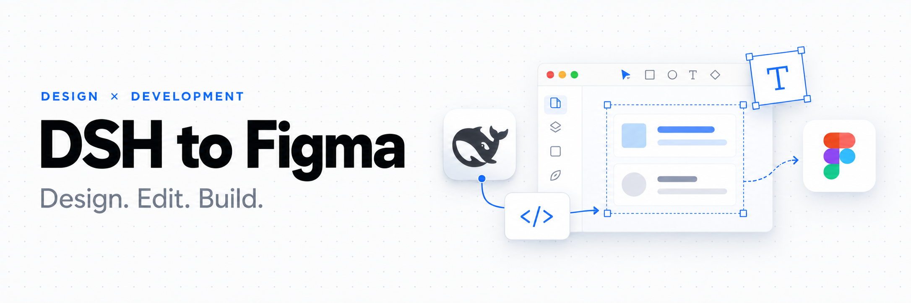
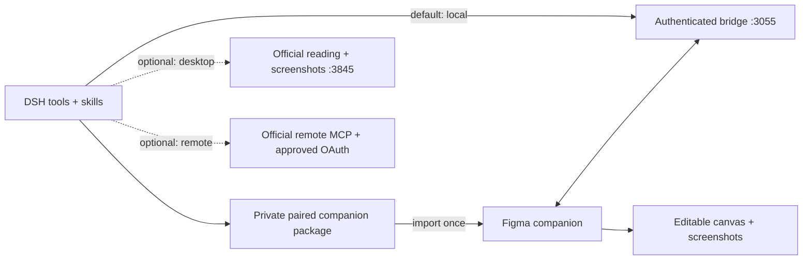

<div align="center">



# DSH to Figma

**Bring Figma canvas tools into DeepSeek Harness.**

Read and edit Figma with a native DSH plugin and an automatically paired canvas companion. Import once, then launch and work.

[](https://github.com/Duoasa/DSH-to-Figma/actions/workflows/ci.yml)
[](LICENSE)
[](https://github.com/deepseek-ai/deepseek-harness)
[](docs/verification.md)
[](https://github.com/awesome-dsh-plugin/awesome-dsh-plugin/blob/main/data/plugins/Duoasa__DSH-to-Figma.yml)

[简体中文](README.md) · **English** · [日本語](README.ja.md)

[Use cases](#use-cases) · [Quick start](#quick-start) · [Tools](#tools) · [Configuration](#configuration) · [Verification](docs/verification.md)

</div>

> **Recommended installation:** download the DSH package from [Releases](https://github.com/Duoasa/DSH-to-Figma/releases/latest). Once installed and running in local mode, **DSH automatically generates a private, pre-paired Figma plugin for this computer**. Ask DSH for `figma_setup`, import its generated manifest once in Figma, then run it to connect. You do not need the standalone generic ZIP or to copy a pairing token. Keep the Figma companion open while working.

## Why DSH to Figma

- **No official Figma MCP quota consumed in local mode.** Read, edit, screenshot and export through the local companion without using official Figma MCP call quotas.
- **Native DSH integration.** Tools, design skills and image attachments use the host's extension points. No agent-loop fork is required. Supported DSH cores: **0.2.0-rc.2** and **0.2.1-rc.2**.
- **Editable design work by default (`local`).** The companion executes public Figma Plugin API scripts inside the selected document. Create and update frames, text, auto layout, components, variants, styles and variables.
- **A design-to-code workflow.** Inspect the layer tree, layout, CSS and assets, then let the host agent implement them in the current workspace.
- **Visual feedback.** Receive canvas screenshots through DSH's native image attachment path. A text-only model receives an explicit diagnostic instead of a pretend visual review.
- **No token copying in the recommended setup.** DSH generates your private, paired Figma plugin automatically. Start it in a file to connect; one connected file is selected automatically. Official desktop MCP remains an optional reading/screenshot mode.

> **0.2.1 verified in Figma Design mode:** automatic pairing, single-file binding, native frame/text creation, independent readback and update, screenshot and PNG export all passed through an installed DSH conversation. This version fixes the Figma sandbox startup failure found in 0.2.0. See [actual results and image](docs/verification.md).

## Use cases

These workflows use the default local mode. Connect the target Figma file and keep the companion running. Code and asset file operations require the corresponding workspace to be open in DSH with write access.

### 1. Existing UI frames → frontend pages

Once a design is ready, ask DSH to inspect the target frame's layer tree, layout, styles/CSS, component information and screenshot, then export the icons and images it needs. DSH can use the current codebase's framework, existing components and conventions to create or update frontend pages, for example in React or Vue projects.

> Read my selected login frame. Inspect this project's stack and components first, then implement the page in the project. Reuse existing components, use the real design assets, and explain how the layout should adapt to small screens.

**The plugin supplies design context and assets; DSH's model and workspace tools implement the frontend code.** Local mode does not call Figma's cloud code generation. Interaction logic, responsive rules, backend APIs and business behavior still need project requirements; a static frame cannot determine them on its own.

### 2. Reference screenshots or written requirements → editable Figma UI

Give DSH a reference image, or describe a page's structure, dimensions and content. It can create native frames, text, vectors and auto layout inside the current Figma file, then refine them. See the real screenshot reconstruction in [Examples](#examples) below.

> Create a 1440 × 900 task management screen on the current page, with a sidebar, task list and details panel. Use editable text and auto layout.

### 3. Batch changes and design iteration

Specify the target frame and scope, then ask DSH to adjust copy, colors, spacing or layout, read the result back and return a screenshot for review. Canvas writes are not transactional, so review larger changes in small steps.

> Set the primary buttons in this frame to 40px high with an 8px corner radius. Check for text overflow and return a screenshot after the changes.

### 4. Reuse components and design variables

Inspect components, styles and variables to carry existing design conventions into new pages. Create or update components, variants and variables within an explicit scope. Component search covers the current page; style and variable search covers the local file. Load another page before inspecting its components; this is not an all-cloud library search. Local component/code references are not published official Code Connect mappings.

> Inspect the button and input components on this page and the file's color variables, then use them to build a settings page.

### 5. Asset handoff and frontend visual review

Export specified layers as SVG, PNG, JPG or PDF into `.figma/assets/<batch>/` in the workspace, then let DSH organize them into the project's asset directory. If the host provides browser or page preview tools and the model supports images, DSH can also compare the implementation against a Figma screenshot and refine the code. Web preview capabilities come from the host.

> Export the icons and images used by this frame and organize them into the project's asset directory. After implementing the page, compare its typography, spacing and alignment against the design.

These are composable workflows, not automatic two-way design/code synchronization or a guarantee of pixel-perfect output. **Real-editor verification** covers local automatic pairing, canvas reading, creation and updates, screenshots, PNG export and the screenshot reconstruction below. Frontend generation, component organization and the other workflows have not each received end-to-end acceptance testing. See the [verification record](docs/verification.md) and [capability boundaries](CAPABILITIES.md).

## Examples

### Read and screenshot with official desktop MCP (optional)

In a DSH Work conversation, provide a link to a frame in the open Figma file:

> Use the official desktop MCP. Check figma_status, read this frame’s metadata, and return a screenshot. Do not modify the canvas.

The real run returned **10 official tools**, `backend: desktop`, `available: true`, and `bridgePort: null`. `get_metadata` read **DeepSeek Harness — Desktop UI**, node `1:4`, **1440 × 900**, including its Sidebar and Main layers. `get_screenshot` returned a **1024 × 640 WebP**, stored as a native DSH image attachment and displayed in the conversation. The image below is that actual MCP result; no canvas changes were made.


### Rebuild a screenshot as editable Figma UI (local mode)

This writing example uses `backend: local` and the running companion. Version 0.2.0 simplifies its setup with automatic pairing. Provide a reference screenshot in DSH, select the target frame in the connected Figma file, and describe what to draw:

> Recreate this UI on the frame I selected. Draw only the UI.

**1. Reference and instruction in DSH.** The request uses a screenshot of the DeepSeek Harness desktop app. The agent identifies the selected frame and plans a 1440 × 900 UI reconstruction without the surrounding desktop background.


**2. Editable result in Figma.** The result contains the sidebar, conversation area and message composer. Figma's layer panel shows separate text, frame and vector layers; the selected frame measures 1440 × 900. These elements can be selected and refined in Figma.


These screenshots were supplied by the maintainer from an actual run on 2026-10-18. They demonstrate this screenshot-to-UI case; they are not a pixel-perfect comparison or verification of every tool and editor mode.

## How it works



DSH prepares a private companion directory and ZIP in `<DSH_HOME>/figma/` on local-mode startup. Import its manifest into Figma once. Each time you run **DSH to Figma · Local**, it connects automatically to this DSH host. Keep its window open. No remote OAuth or personal access token is needed.

The private package contains a local credential; keep it on your machine. Public distribution packages contain no credentials. The bridge remains authenticated and loopback-only; automatic pairing does not expose an unauthenticated token endpoint. Idle connections retry automatically, but interrupted canvas operations are never replayed.

## Quick start

### 1. Install the DSH bundle

Prerequisites: a supported DSH host and Figma desktop for development-plugin import. Git is only needed for source installation. Use the Node version required by the host; repository development uses Node **24+**. Tested DSH cores: **0.2.0-rc.2** and **0.2.1-rc.2**. Local mode uses Figma’s Plugin API, not the paid desktop MCP seat entitlement; normal account, file-edit and editor permissions still apply.

#### Option A: ask DSH to install it

Paste the prompt below into a DSH conversation with network access, terminal tools and permission to install locally. DSH performs the installation; follow its instructions when a host restart or the first Figma plugin import is needed.

```text
Install DSH to Figma in the DSH host I am currently using:
https://github.com/Duoasa/DSH-to-Figma

1. Read the repository README installation instructions. Identify this host's DSH core version, CLI, profile and DSH_HOME. Use this host's CLI without changing another DSH installation or client; ask me if the target is ambiguous.
2. Download dsh-to-figma-<version>.tgz and SHA256SUMS from the latest stable GitHub Release. Verify SHA-256 and version compatibility. Do not guess an npm package or substitute the generic Figma companion ZIP for the DSH bundle.
3. Use the host CLI to run plugin --profile <current profile> add "file:<absolute downloaded package path>". Install into the current profile and use local mode. Preserve other plugin settings and avoid enabling an old dsh-figma entry alongside the new one.
4. Check that the plugin is running. If I need to restart DSH, tell me first and continue after the restart. A successful install command is not proof of a working connection.
5. Once the tools are available, call figma_setup and give me the full path to the generated manifest.json. Guide me through importing it once in Figma desktop and running DSH to Figma · Local with its window kept open. Do not print the pairing credential, read the generated code or upload the paired package.
6. After I run the companion in the target file, call figma_status to verify the connection. Ask me to choose if multiple files are connected. Initially, only read frame information and return a screenshot; leave existing designs unchanged.
```

If the original conversation does not discover the new tools after installation, restart or open a new conversation and use the connection prompt in step 2 below. This prompt guides the existing CLI installation workflow; it is not a separate one-click installer. **On 2026-10-18, the Chinese equivalent was sent unchanged to DSH Desktop 0.2.1-rc.2**: DSH downloaded, verified and reinstalled release 0.2.1, then connected to Figma after a host restart, read four frames and returned an actual screenshot. The run required one installation approval, a host restart and a response to a duplicate-name connection question; the next check showed a single connection again. It reused an already-imported Figma companion, so first-time import on a clean environment remains untested in this run. The English prompt was not run separately. See the [verification record](docs/verification.md#installation-prompt-acceptance--安装提示词实测).

#### Option B: install manually with the CLI

Download **dsh-to-figma-0.2.1.tgz** from [Releases](https://github.com/Duoasa/DSH-to-Figma/releases/latest). **The package is not published to npm.** Install the downloaded package with your host's CLI:

```sh
dsh plugin --profile web add "file:/absolute/path/dsh-to-figma-0.2.1.tgz"
```

Use your actual profile instead of `web`. The host package manager installs runtime dependencies; no build is required.

**Official macOS DSH Desktop:** use the desktop-bundled CLI for the reserved `desktop` profile:

```sh
"/Applications/DeepSeek Harness.app/Contents/Resources/runtime/cli/bin/dsh" \
  plugin --profile desktop add "file:/absolute/path/dsh-to-figma-0.2.1.tgz"
```

Replace the package path with the file you downloaded. Adjust the app path if needed. A separate globally installed `dsh` may be older and refuse to manage `desktop`.

Alternatively, clone the source and install its folder using the same host CLI, replacing the package argument with `"file:$PWD"` from inside the repository. Git is required only for this alternative.

Open **Plugins → DSH to Figma** and confirm the component is **running**. Restart the host if it does not reload automatically. Installation success alone does not prove runtime health.

Use the CLI, profile and `DSH_HOME` belonging to the host with a compatible DSH core. Disable/remove any earlier development version of this plugin before enabling this package; duplicate versions share the same entry ID and local bridge port.

### 2. Import the automatically paired Figma plugin once

After DSH starts in local mode, ask it:

> Help me connect Figma. Call figma_setup and give me the paired manifest path. Do not show the credential or read the generated code.

With the default DSH home, the manifest is:

```text
~/.dsh/figma/companion/manifest.json
```

1. In Figma desktop, choose **Plugins → Development → Import plugin from manifest…**.
2. Select the generated manifest. On macOS, use **⌘⇧G** in the file picker to enter its full path.
3. Open the target Design file and run **DSH to Figma · Local**.
4. It connects automatically; there is no token field to fill in the normal flow. Keep the plugin window open.

The path is stable across DSH plugin updates; run the Figma plugin again after an update. Do not move/delete that directory. If you prefer an archive, `figma_setup` also returns **DSH-to-Figma-paired.zip**, a private copy for this host. Extract it to a permanent directory before import; that extracted copy must be refreshed manually after updates.

### 3. Start working

> Inspect the connected Figma file, then create a separate auto-layout card titled “Hello from DSH”. Return its node ID, read it back, and show a screenshot. Leave existing artwork unchanged.

With one connected file, the first canvas call binds it automatically. With multiple files, DSH explicitly chooses a target. Existing bindings never silently switch after disconnect. Writes can leave partial changes on failure; inspect before retrying.

**Upgrading from 0.1.5:** if your profile explicitly sets `backend: desktop`, change it to `local` and reload/restart. The package default does not overwrite an explicit user preference. The [setup guide](docs/setup.md) includes the patch.

### Standalone Figma package — manual-pairing fallback

**Not needed for the recommended setup.** DSH generates your paired companion automatically. The separate `DSH-to-Figma-companion-0.2.1.zip` on [Releases](https://github.com/Duoasa/DSH-to-Figma/releases/latest) is a credential-free generic package that requires manual pairing. Successful [GitHub Actions builds](https://github.com/Duoasa/DSH-to-Figma/actions/workflows/ci.yml) also provide both public packages as **DSH-to-Figma-packages**.

The generated private companion directory and `DSH-to-Figma-paired.zip` contain this host’s credential; keep them on your computer and do not upload or share them. They are never included in the public release.

`npm run package:companion` creates `dist/DSH-to-Figma-companion-0.2.1.zip`, containing the manifest, compiled plugin, UI, bilingual install notes and license. It is safe to distribute and contains no credentials. For zero-copy pairing, use the private package generated by **your own** DSH instead; the generic package offers a manual-token fallback under Advanced.

The local CLI alternative is `node /absolute/path/to/plugin/cli.mjs setup --home /absolute/path/to/dsh-home`; it prints installation paths, never the pairing token.

## Tools

Default local mode registers **17 canvas tools** under `mcp__figma__…`, plus five setup/guidance tools. Optional official modes dynamically expose their actual server catalog. Desktop MCP has no `use_figma` canvas-writing tool.

| Workflow | Local tools |
| --- | --- |
| Canvas scripting | `use_figma`, `import_scene` |
| Inspection | `get_selection`, `list_fonts`, `get_metadata` |
| Visual/design context | `get_screenshot`, `get_design_context`, `get_figjam` |
| Design systems | `get_variable_defs`, `get_libraries`, `search_design_system`, `get_component_context` |
| Component/code references | `get_local_component_links`, `set_local_component_links` |
| Motion inspection | `get_motion_context` |
| Asset transfer | `upload_assets`, `download_assets` |
| Setup and guidance | `figma_setup`, `figma_status`, `figma_select_document`, `figma_read_guide`, `figma_reconnect` |

The bundled `figma-workbench` skill includes focused guides for canvas scripting, design-to-code, components/variables, assets/scenes, FigJam/Slides and official services. Local component links are plugin data, **not published Code Connect mappings**. Search covers the implemented local scope, not all cloud libraries. Public API scripting can target Design, FigJam and Slides; editor-specific acceptance is pending.

See [capability coverage](CAPABILITIES.md) for cloud-only features and contract differences.

## Configuration

Configure the `dsh-figma` entry through your host's native plugin configuration. These are **entry config fields**, not a complete profile patch:

| Field | Default | Purpose |
| --- | --- | --- |
| `backend` | `local` | `local`, `desktop` or `remote` |
| `bridgePort` | `3055` | Local companion bridge |
| `desktopServerUrl` | `http://127.0.0.1:3845/mcp` | Official desktop endpoint |
| `toolCallTimeoutMs` | `120000` | Tool timeout, 1–300 seconds |
| `oauthClientId` | empty | Approved remote OAuth client ID, when required |

Changing `bridgePort` regenerates the paired companion with the matching endpoint and manifest allowlist. Restart DSH and rerun/reimport the generated companion as needed. Multiple hosts should use different ports and their own generated companions.

- **Local mode (default):** automatic private companion preparation, launch-to-connect and single-document selection.
- **Desktop mode (optional):** enable Figma’s built-in desktop MCP, set `backend: desktop`, and restart/reload DSH. Reading and screenshots only; no companion. See [Figma’s seat requirements](https://developers.figma.com/docs/figma-mcp-server/local-server-installation/).
- **Remote mode:** use `dsh-figma login` and `backend: remote`. Official availability depends on Figma client approval, account, seat and server catalog. No Codex credentials are reused.
- **Disable:** use the native plugin manager, or launch the host with `DSH_FIGMA_DISABLED=1`.

[Detailed setup, OAuth and troubleshooting →](docs/setup.md)

## Data and execution boundaries

- The local bridge binds only loopback, checks Host/Origin and requires a pairing token on every request. Tokens are stored under `DSH_HOME/figma` with private filesystem permissions; the paired companion contains a private copy on disk and holds it in memory while running. It does not store it in Figma document data or clientStorage.
- Figma scripts execute inside the editor through the public Plugin API. The DSH bundle itself runs with host process privileges, as other native plugins do.
- In local mode, one connected document is bound on first use. Multiple documents and disconnected bindings require explicit selection. Operations are ordered per document; unknown writes are never automatically replayed. Mutations are not transactional.
- Asset uploads must stay inside the Work workspace. Exports use fresh `.figma/assets/<batch>/` directories. Screenshots may be sent to your configured model provider as part of the conversation.
- OAuth credentials are stored in a private local file, **not encrypted with the OS keychain**. `dsh-figma logout` removes local credentials; revoke Figma app access separately to invalidate the grant server-side.

## Development

```sh
npm ci --ignore-scripts
npm run test:all
npm pack --ignore-scripts
```

`check` regenerates `companion/code.js` from its sources and validates syntax/package files. The tests cover HTTP authentication, document queues, cancellation/recovery, assets, OAuth, official MCP discovery, and actual DSH service/attachment integration. Figma API behavior in automated tests uses fixtures.

```text
index.mjs             Native DSH plugin entry
cli.mjs               Install, pairing and OAuth helper (dsh-figma)
lib/                  Bridge, tool catalog, assets and official transports
companion/            Figma development plugin; generated code.js is shipped
skills/               Agent workflow skill and focused references
test/                 Unit, protocol and native DSH integration tests
docs/                 Setup and verification details
```

For another installed runtime, see [verification instructions](docs/verification.md). Contributions and reproducible issues are welcome; include DSH version, backend and error text, and remove tokens and private design data.

## Credits and license

Built on [DeepSeek Harness](https://github.com/deepseek-ai/deepseek-harness), the [Figma Plugin API](https://developers.figma.com/docs/plugins/api/figma/) and the [Model Context Protocol SDK](https://github.com/modelcontextprotocol/typescript-sdk).

README organization draws on community projects [dsh-context](https://github.com/bowenliang123/dsh-context), [dsh-plugin-shop](https://github.com/LivXue/dsh-plugin-shop) and [dsh-openpencil](https://github.com/ZSeven-W/dsh-openpencil). Their code and screenshots are not bundled here.

[MIT](LICENSE) · Copyright © 2026 Duoasa.
