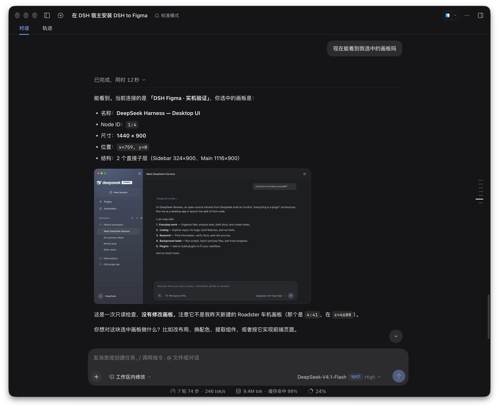
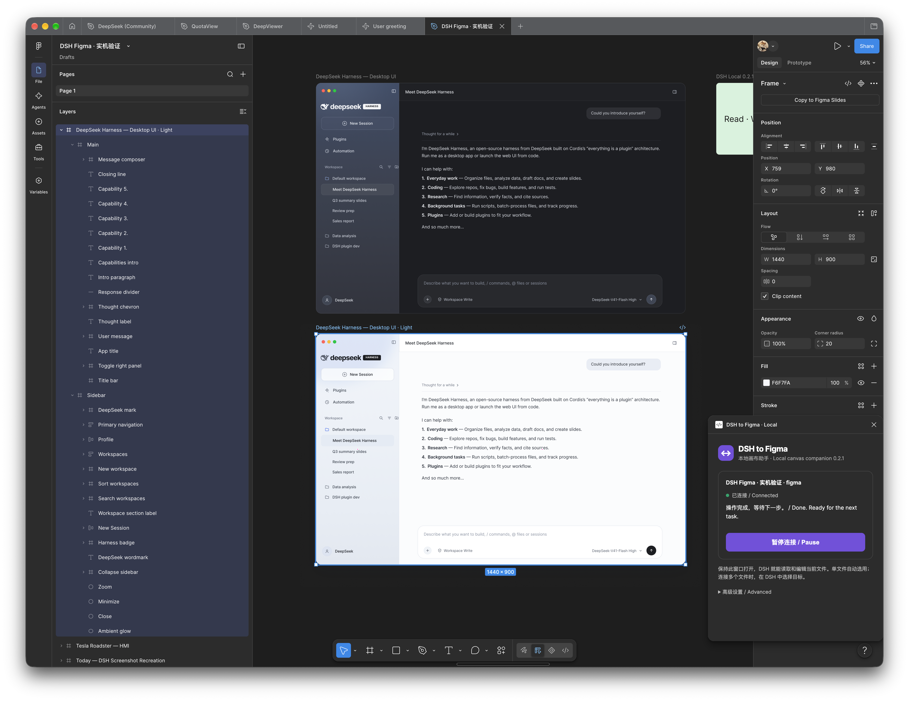
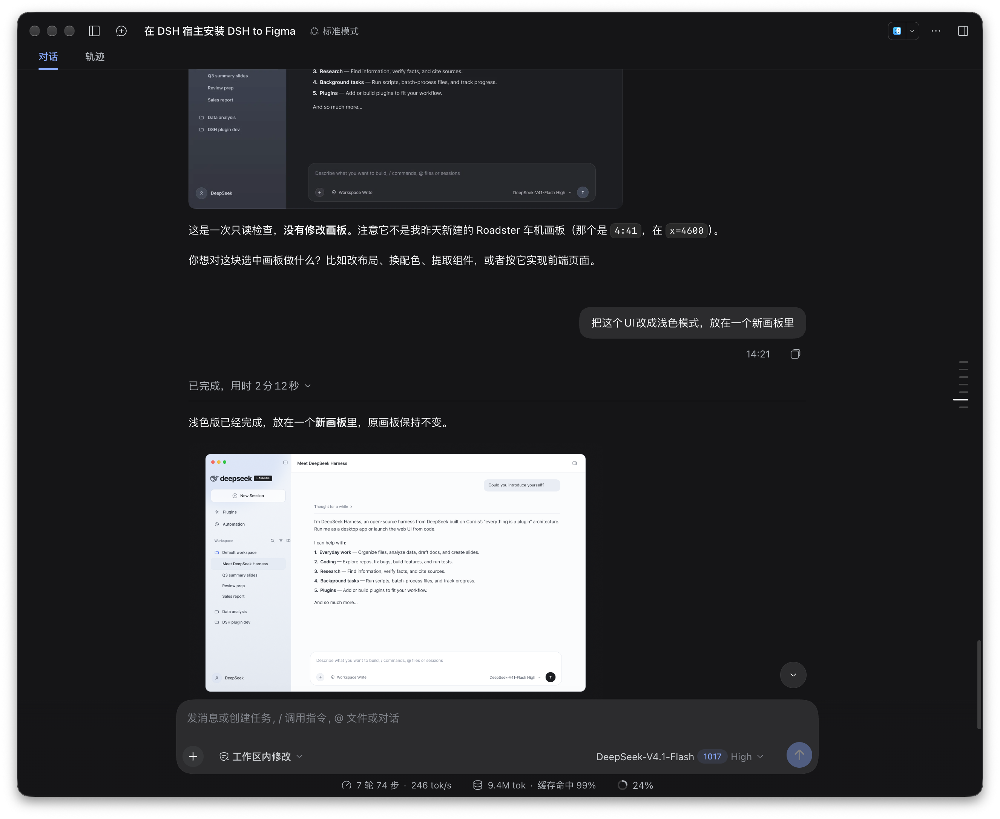
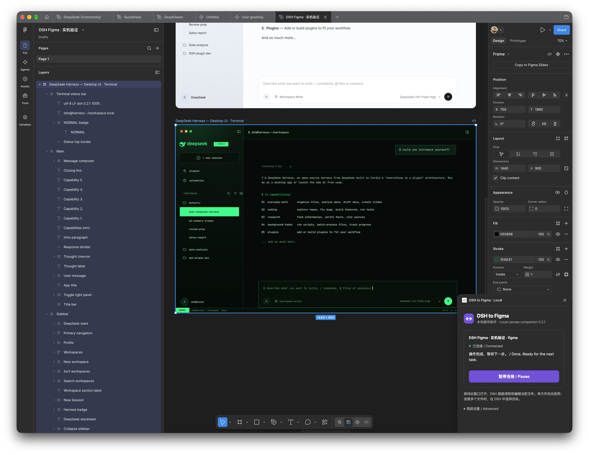
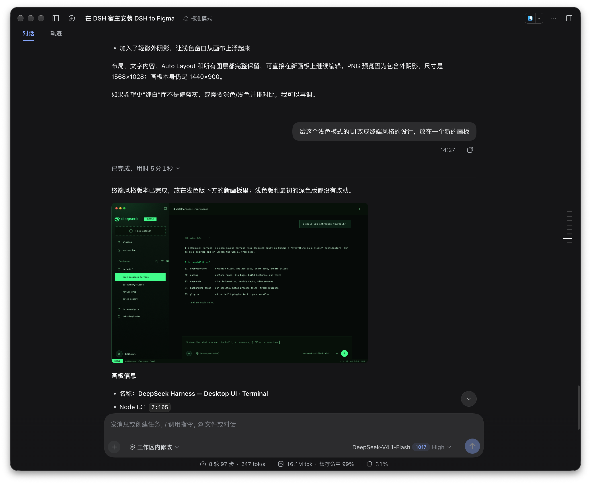

<div align="center">


# DSH to Figma

**自然な言葉で Figma のデザインを読み取り、作成・編集。**

DeepSeek Harness と Figma をつなぎ、要件、参考画像、既存のデザインから編集可能な画面を作ります。

[](https://github.com/Duoasa/DSH-to-Figma/releases/latest)
[](LICENSE)
[](https://github.com/deepseek-ai/deepseek-harness)

[简体中文](README.md) · [English](README.en.md) · **日本語**

[プロンプトでインストール](#プロンプトでインストール) · [主な機能](#主な機能) · [実際の操作例](#実際の操作例) · [手動インストール](#手動インストール)

</div>

**ローカルモードでは公式 Figma MCP の呼び出し枠を消費しません。** DSH がこの PC 用のペアリング済み Figma プラグインを生成します。初回にインポートすれば、以後は起動するだけで接続できます。

## プロンプトでインストール

普段使っている DSH に、次の文章を送ってください。

```text
DSH to Figma をインストール、または更新してください。
https://github.com/Duoasa/DSH-to-Figma

リポジトリの最新 README に従って進めてください。
1. 現在のホストの設定と実行環境から CLI、profile、DSH_HOME を確認し、そのホストの CLI を使用する。既存設定と他のプラグインを保持し、対象を特定できない場合だけ確認する。
2. GitHub の最新正式 Release から dsh-to-figma-<バージョン>.tgz と SHA256SUMS を取得して SHA-256 を検証する。npm のバージョンを推測したり、Figma 用 ZIP を DSH 用パッケージとして使ったりしない。
3. ホストの plugin --profile <現在のprofile> add コマンドでインストールまたは更新し、local モードを使用する。既存のものはそのまま更新し、重複が確認できた場合だけ重複項目を整理する。
4. コンポーネントが実行中で、ツールが利用できることを確認する。ホストの再起動が必要なら伝え、再起動後に接続設定を続ける。
5. figma_setup を呼び出し、ペアリング済み manifest.json の絶対パスを提示する。Figma Desktop でインポートし DSH to Figma · Local を実行する手順を案内する。導入済みなら同じフォルダーを更新して再実行する。ペアリング情報を表示したり、生成ファイルをアップロードしたりしない。
6. 対象の Figma ファイルでプラグインを実行した後、figma_status で両側のバージョンと接続を確認する。複数ファイルがある場合は対象を確認し、選択中のアートボードを読み取ってスクリーンショットを返す。この段階では既存デザインを変更しない。
```

Figma Desktop の **Plugins → Development → Import plugin from manifest…** から、案内された manifest を選びます。対象ファイルで **DSH to Figma · Local** を実行し、ウィンドウを開いたままにしてください。

通常のパスは `~/.dsh/figma/companion/manifest.json` ですが、`figma_setup` の返すパスを使用してください。更新時は両側を更新し、元のフォルダーを保持したまま Figma プラグインを閉じて再実行します。

## 主な機能

| やりたいこと | 操作 |
| --- | --- |
| 既存デザインを理解する | 選択中の画面、レイヤー、文字、サイズ、レイアウト、スタイル、スクリーンショットを取得 |
| 要件や参考画像から作る | ネイティブのフレーム、文字、ベクター、Auto Layout を作成して調整 |
| まとめて編集する | 文言、色、文字サイズ、余白、角丸、レイアウトを変更し、名前・属性・階層でレイヤーを検索 |
| デザインシステムを整える | コンポーネント、バリアント、インスタンス、スタイル、変数、モード、エイリアスとバインドを作成・編集 |
| デザインからコードへ | デザイン情報と素材を現在のプロジェクトに合わせてフロントエンドへ反映 |
| 素材を受け渡す | 画像・SVG のインポート、PNG・JPG・SVG・PDF のエクスポート、スクリプト出力の保存 |
| 文書形式に合わせて作業する | FigJam の図、Slides の内容、プロトタイプのインタラクションを整理 |

たとえば、次のように依頼できます。

> 選択中の画面の主要ボタンを高さ 40px、角丸 8px にそろえ、変更後のスクリーンショットを見せて。

> 既存の色変数とボタンを再利用し、Auto Layout でライトテーマのダッシュボードを新しく作って。

> このボタンにホバー状態と無効状態を追加し、色をセマンティック変数にバインドして。

> この参考画像を新しいアートボードで再現し、文字とレイアウトを編集できるようにして。

> この画面を現在のプロジェクトに実装し、既存コンポーネントを再利用して必要な素材を出力して。

プラグインがモデルと画布・ツールをつなぎます。会話を続けて調整することも、Figma で直接編集することもできます。

## 実際の操作例

2026 年 10 月 19 日の連続した操作例です。既存のダーク UI を読み取り、新しいアートボードにライト版を作成し、さらにターミナル風のデザインへ展開しました。

### 1. 選択中のアートボードを確認

> 選択したアートボードが見えますか？

DSH が名前、ノード ID、1440 × 900 のサイズ、レイヤー構成とスクリーンショットを返します。



### 2. 元の画面を残してライト版を作成

> この UI をライトモードにして、新しいアートボードに置いて。

ダーク版を残したまま、独立したライト版を作成。文字、サイドバー、メッセージ領域などを Figma 上で引き続き編集できます。



<details>
<summary>DSH の指示と返答を見る</summary>



</details>

### 3. ターミナル風のデザインへ展開

> ライト版をターミナル風にして、別の新しいアートボードに置いて。

暗い背景、緑のアクセント、等幅文字を使った別案を作成し、以前の版と比較できます。



<details>
<summary>DSH の指示と返答を見る</summary>



</details>

## 手動インストール

[最新 Release](https://github.com/Duoasa/DSH-to-Figma/releases/latest) から DSH パッケージと `SHA256SUMS` を取得し、チェックサムを確認してからホストの CLI でインストールします。

**macOS DSH Desktop：**

```sh
"/Applications/DeepSeek Harness.app/Contents/Resources/runtime/cli/bin/dsh" \
  plugin --profile desktop add "file:/absolute/path/dsh-to-figma-0.3.0.tgz"
```

**その他の DSH ホスト：**

```sh
dsh plugin --profile <your-profile> add "file:/absolute/path/dsh-to-figma-0.3.0.tgz"
```

パスと profile は実際の値に変更してください。デスクトップ版はアプリ付属の CLI を優先します。プラグイン画面で **DSH to Figma → 実行中** を確認し、`figma_setup` を呼び出してください。

通常は DSH が生成するペアリング済みプラグインを使います。`DSH-to-Figma-companion-0.3.0.zip` は手動ペアリング用の予備パッケージです。ペアリング済みのフォルダーと ZIP には認証情報が含まれるため、この PC 内に保管してください。

## 接続と設定

標準の `local` モードではローカルサービス経由で接続します。接続中のファイルが一つなら自動選択し、複数ある場合は対象を指定します。

| 設定 | 初期値 | 用途 |
| --- | --- | --- |
| `backend` | `local` | `local`、`desktop`、`remote` の選択 |
| `bridgePort` | `3055` | ローカル接続ポート |
| `toolCallTimeoutMs` | `120000` | ツール呼び出しのタイムアウト（ミリ秒） |
| `desktopServerUrl` | `http://127.0.0.1:3845/mcp` | デスクトップ MCP のアドレス |
| `oauthClientId` | 空 | リモートログインのクライアント設定 |

ホストのプラグイン設定から変更できます。[詳しい接続方法](docs/setup.md)。

更新後にツールが表示されない場合は、ホスト、profile、プラグイン画面を確認し、DSH を再読み込みまたは再起動してください。Figma 側も閉じて再実行します。問題報告には両側のバージョンとエラーを添えてください。

## 開発・コントリビューション

```sh
npm ci --ignore-scripts
npm run test:all
npm run package:companion
npm pack --ignore-scripts
```

ソースには DSH エントリー、接続ブリッジ、Figma companion、ワークフロー Skill が含まれます。改善案や再現手順付きの報告を歓迎します。

ホスト互換性へのフィードバックと貢献をいただいた [heeq666](https://github.com/heeq666)、[miztizm](https://github.com/miztizm) に感謝します。

[DeepSeek Harness](https://github.com/deepseek-ai/deepseek-harness)、[Figma Plugin API](https://developers.figma.com/docs/plugins/)、[Model Context Protocol SDK](https://github.com/modelcontextprotocol/typescript-sdk) を使用しています。

[MIT](LICENSE) · Copyright © 2026 Duoasa.
