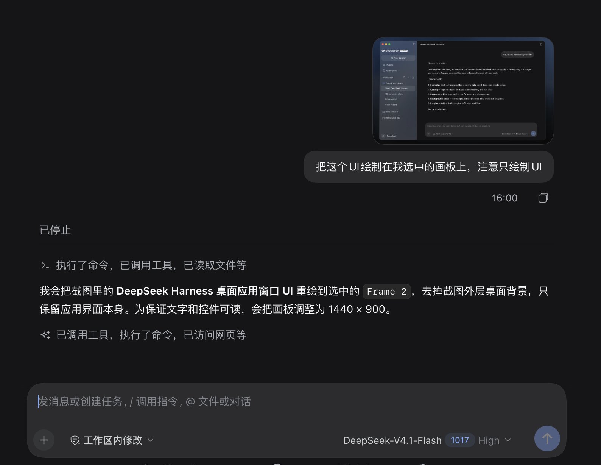
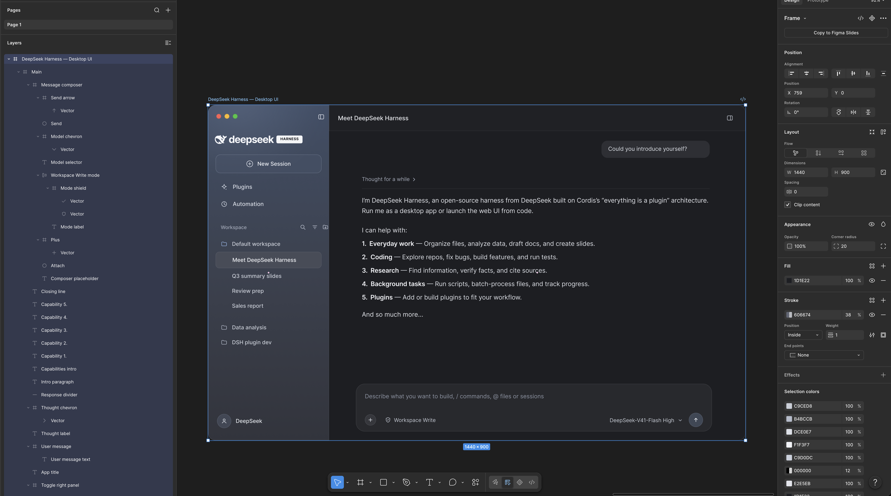
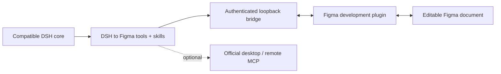

<div align="center">

# DSH to Figma

**Bring Figma canvas tools into DeepSeek Harness.**

Read designs, edit native layers, work with components and variables, and return screenshots to your agent.

[](https://github.com/Duoasa/DSH-to-Figma/actions/workflows/ci.yml)
[](LICENSE)
[](https://github.com/deepseek-ai/deepseek-harness)
[](docs/verification.md)

**English** · [简体中文](README.zh-CN.md)

[Quick start](#quick-start) · [Tools](#tools) · [Configuration](#configuration) · [Verification](docs/verification.md)

</div>

## Why DSH to Figma

- **Native DSH integration.** Tools, design skills and image attachments use the host's extension points. No agent-loop fork is required. Supported DSH cores: **0.2.0-rc.2** and **0.2.1-rc.2**.
- **Editable design work.** The companion executes public Figma Plugin API scripts inside the selected document. Create and update frames, text, auto layout, components, variants, styles and variables.
- **A design-to-code workflow.** Inspect the layer tree, layout, CSS and assets, then let the host agent implement them in the current workspace.
- **Visual feedback.** Export PNG screenshots through DSH's native image attachment path. A text-only model receives an explicit diagnostic instead of a pretend visual review.
- **Local or official MCP.** Use the paired local companion by default, or connect to Figma's official desktop/remote MCP server and discover its available tools.

> **Preview status:** native DSH loading and automated protocol/runtime tests pass. Real Figma companion import and local pairing have been verified; the maintainer's example below demonstrates UI reconstruction as editable layers. Full readback/edit/export and broader editor acceptance remain pending. This is an independent integration, not an official DeepSeek/Figma product or a claim of full Codex feature parity. See the [verification record](docs/verification.md) and [capability matrix](CAPABILITIES.md).

## Examples

### Rebuild a screenshot as editable Figma UI

Provide a reference screenshot in DSH, select the target frame in the connected Figma file, and describe what to draw:

> Recreate this UI on the frame I selected. Draw only the UI.

**1. Reference and instruction in DSH.** The request uses a screenshot of the DeepSeek Harness desktop app. The agent identifies the selected frame and plans a 1440 × 900 UI reconstruction without the surrounding desktop background.



**2. Editable result in Figma.** The result contains the sidebar, conversation area and message composer. Figma's layer panel shows separate text, frame and vector layers; the selected frame measures 1440 × 900. These elements can be selected and refined in Figma.



These screenshots were supplied by the maintainer from an actual run on 2026-10-18. They demonstrate this screenshot-to-UI case; they are not a pixel-perfect comparison or verification of every tool and editor mode.

## How it works



The companion connects to `http://localhost:3055`; the bridge listens only on `127.0.0.1:3055`. The companion stays open in Figma; each DSH Work session explicitly selects a connected document. Local pairing does not require a Figma personal access token or remote OAuth approval. Figma itself still needs its normal account and document access.

## Quick start

### 1. Install the DSH bundle

Prerequisites: Git, Node.js **24+** for development, a supported DSH host, and the Figma desktop app for the local companion. The plugin declares Node 22+; use the Node runtime required by your DSH host. Tested DSH cores: **0.2.0-rc.2** and **0.2.1-rc.2**.

This repository is the distribution source; **the package is not published to npm**. Clone it and install the local folder:

```sh
git clone https://github.com/Duoasa/DSH-to-Figma.git
cd DSH-to-Figma
dsh plugin --profile web add "file:$PWD"
```

Use your actual profile instead of `web`. The host package manager installs runtime dependencies; there is no build step for installation because the generated Figma companion is committed.

**Official macOS DSH Desktop:** use the desktop-bundled CLI for the reserved `desktop` profile. If your app is installed at this location:

```sh
"/Applications/DeepSeek Harness.app/Contents/Resources/runtime/cli/bin/dsh" \
  plugin --profile desktop add "file:$PWD"
```

Adjust the app path for your installation. A separate globally installed `dsh` may be older and refuse to manage `desktop`. Alternatively, add the absolute local repository path in DSH's native plugin manager.

Open **Plugins → DSH to Figma** and confirm the component is **running**. Restart the host if it does not reload automatically. Installation success alone does not prove runtime health.

Use the CLI, profile and `DSH_HOME` belonging to the host with a compatible DSH core. Disable/remove any earlier development version of this plugin before enabling this package; duplicate versions share the same entry ID and local bridge port.

### 2. Pair Figma

For the default DSH home and desktop profile:

```sh
node "$HOME/.dsh/profiles/desktop/node_modules/dsh-to-figma/cli.mjs" \
  pair --home "$HOME/.dsh"
```

For another profile/home, change the path and `--home` together. The command prints the installed companion manifest path and a **local secret**; paste that secret only into the companion, not into a chat, issue or screenshot.

1. In Figma desktop, open a test Design file.
2. Choose **Plugins → Development → Import plugin from manifest…** and select the printed `companion/manifest.json`.
3. Run **DSH to Figma**, paste the pairing token, and click **Connect**.
4. Keep the plugin open. In a DSH **Work session with a workspace**, ask the agent to call `figma_status`, then `figma_select_document` with the intended connection ID.

### 3. Try a complete workflow

Ask your agent:

> Read the figma-workbench skill. Show connected Figma documents and bind the test file I named. Inspect the page, then create an auto-layout card titled “Hello from DSH”. Return its node IDs, read the card back, change the title to “Connected”, and return a screenshot. Do not edit existing artwork.

The intended loop is **inspect → edit → read back → screenshot**. If a write times out, inspect the canvas before retrying. A timeout does not roll back Figma changes.

## Tools

Local mode registers **17 canvas tools** under `mcp__figma__…`, plus four setup/guidance tools.

| Workflow | Local tools |
| --- | --- |
| Canvas scripting | `use_figma`, `import_scene` |
| Inspection | `get_selection`, `list_fonts`, `get_metadata` |
| Visual/design context | `get_screenshot`, `get_design_context`, `get_figjam` |
| Design systems | `get_variable_defs`, `get_libraries`, `search_design_system`, `get_component_context` |
| Component/code references | `get_local_component_links`, `set_local_component_links` |
| Motion inspection | `get_motion_context` |
| Asset transfer | `upload_assets`, `download_assets` |
| Setup and guidance | `figma_status`, `figma_select_document`, `figma_read_guide`, `figma_reconnect` |

The bundled `figma-workbench` skill includes focused guides for canvas scripting, design-to-code, components/variables, assets/scenes, FigJam/Slides and official services. Local component links are plugin data, **not published Code Connect mappings**. Search covers the implemented local scope, not all cloud libraries. Public API scripting can target Design, FigJam and Slides; editor-specific acceptance is pending.

See [capability coverage](CAPABILITIES.md) for cloud-only features and contract differences.

## Configuration

Configure the `dsh-figma` entry through your host's native plugin configuration. These are **entry config fields**, not a complete profile patch:

| Field | Default | Purpose |
| --- | --- | --- |
| `backend` | `local` | `local`, `desktop` or `remote` |
| `bridgePort` | `3055` | Local companion bridge |
| `desktopServerUrl` | `http://127.0.0.1:3845/mcp` | Official desktop endpoint |
| `toolCallTimeoutMs` | `120000` | Tool timeout, 1–300 seconds |
| `oauthClientId` | empty | Approved remote OAuth client ID, when required |

Changing `bridgePort` also requires updating the companion UI endpoint and manifest `devAllowedDomains`. Keep `3055` unless you intentionally maintain that customization.

- **Desktop mode:** enable Figma's desktop MCP server, select `backend: desktop`, then refresh with `figma_reconnect`.
- **Remote mode:** use `dsh-figma login` and `backend: remote`. Official availability depends on Figma client approval, account, seat and server catalog. No Codex credentials are reused.
- **Disable:** use the native plugin manager, or launch the host with `DSH_FIGMA_DISABLED=1`.

[Detailed setup, OAuth and troubleshooting →](docs/setup.md)

## Data and execution boundaries

- The local bridge binds only loopback, checks Host/Origin and requires a pairing token on every request. Tokens are stored under `DSH_HOME/figma` with private filesystem permissions; the companion keeps the token only in memory.
- Figma scripts execute inside the editor through the public Plugin API. The DSH bundle itself runs with host process privileges, as other native plugins do.
- Document binding is explicit. Operations are ordered per document; unknown writes are never automatically replayed. Mutations are not transactional.
- Asset uploads must stay inside the Work workspace. Exports use fresh `.figma/assets/<batch>/` directories. Screenshots may be sent to your configured model provider as part of the conversation.
- OAuth credentials are stored in a private local file, **not encrypted with the OS keychain**. `dsh-figma logout` removes local credentials; revoke Figma app access separately to invalidate the grant server-side.

## Development

```sh
npm ci --ignore-scripts
npm run test:all
npm pack --ignore-scripts
```

`check` regenerates `companion/code.js` from its sources and validates syntax/package files. The tests cover HTTP authentication, document queues, cancellation/recovery, assets, OAuth, official MCP discovery, and actual DSH service/attachment integration. Figma API behavior in automated tests uses fixtures.

```text
index.mjs             Native DSH plugin entry
cli.mjs               Install, pairing and OAuth helper (dsh-figma)
lib/                  Bridge, tool catalog, assets and official transports
companion/            Figma development plugin; generated code.js is shipped
skills/               Agent workflow skill and focused references
test/                 Unit, protocol and native DSH integration tests
docs/                 Setup and verification details
```

For another installed runtime, see [verification instructions](docs/verification.md). Contributions and reproducible issues are welcome; include DSH version, backend and error text, and remove tokens and private design data.

## Credits and license

Built on [DeepSeek Harness](https://github.com/deepseek-ai/deepseek-harness), the [Figma Plugin API](https://developers.figma.com/docs/plugins/api/figma/) and the [Model Context Protocol SDK](https://github.com/modelcontextprotocol/typescript-sdk).

README organization draws on community projects [dsh-context](https://github.com/bowenliang123/dsh-context), [dsh-plugin-shop](https://github.com/LivXue/dsh-plugin-shop) and [dsh-openpencil](https://github.com/ZSeven-W/dsh-openpencil). Their code and screenshots are not bundled here.

[MIT](LICENSE) · Copyright © 2026 Duoasa.
