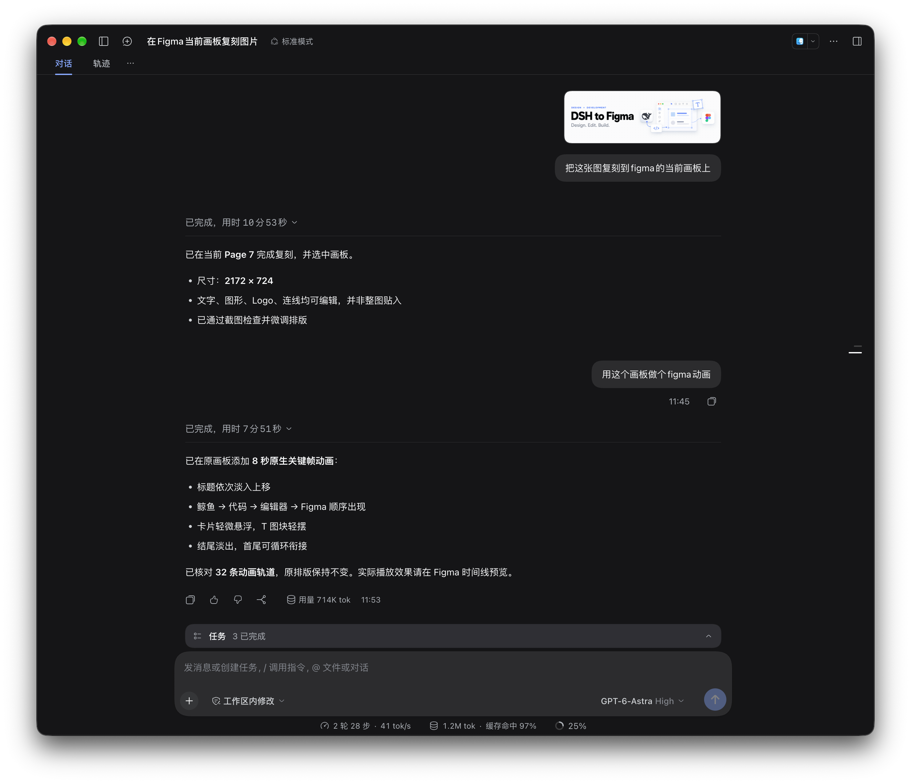
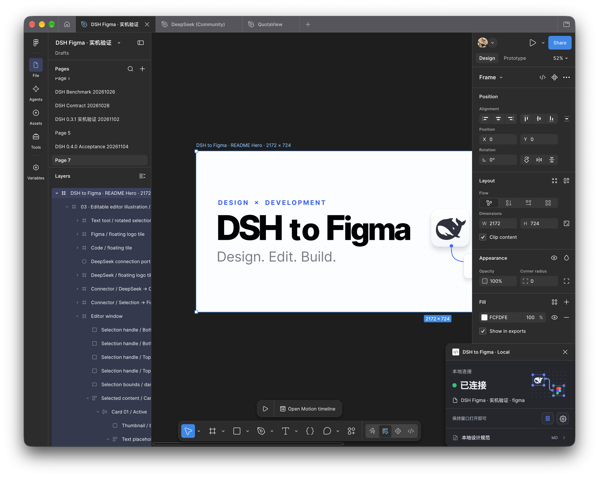
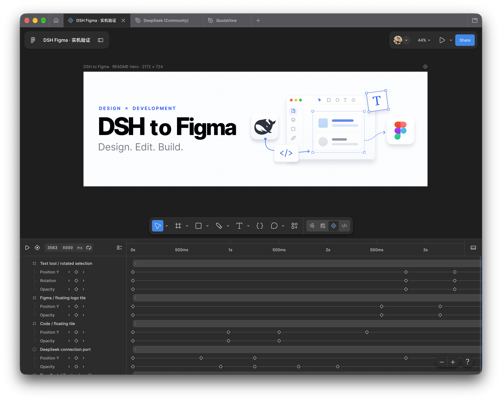
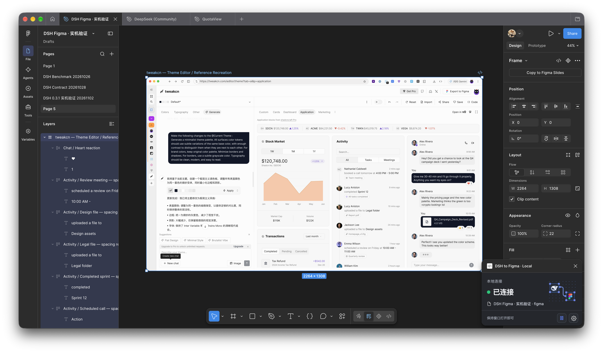
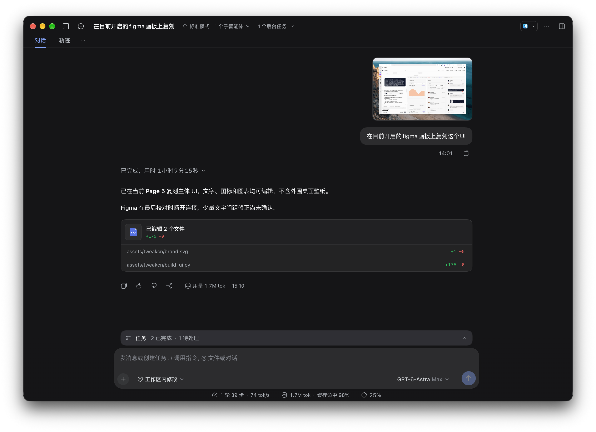

<div align="center">


<sub>标题设计与动画均使用 DSH to Figma 制作。</sub>

# DSH to Figma

**用自然语言读懂、创建和修改 Figma 设计。**

连接 DeepSeek Harness 与 Figma，把需求、参考图和设计稿变成可以继续编辑的画布。

[](https://github.com/Duoasa/DSH-to-Figma/releases/latest)
[](LICENSE)
[](https://github.com/deepseek-ai/deepseek-harness)
[](https://github.com/awesome-dsh-plugin/awesome-dsh-plugin/blob/main/data/plugins/Duoasa__DSH-to-Figma.yml)

**简体中文** · [English](README.en.md) · [日本語](README.ja.md)

[提示词安装](#安装把下面这段话发给-dsh) · [能做什么](#能做什么) · [实机演示](#实机演示) · [手动安装](#手动安装)

</div>

**本地模式不消耗官方 Figma MCP 调用额度。** DSH 会自动生成本机已配对的 Figma 插件，首次导入一次，之后运行即可连接。

## 0.4.0 新功能（发布准备中）

| 新功能 | 你可以做什么 |
| --- | --- |
| 原生动效 | 创建和调整关键帧、文字入场与动画样式，继续在 Figma 时间线中编辑 |
| 本地设计规范 | 导入 Markdown，让 DSH 读取、修改并导出规范副本 |
| 默认规范 | 选择一份设为默认，后续设计自动读取；重启后保留，直到切换或清除 |
| 能力检测 | 操作前确认当前编辑器支持什么，明确提示不可用的功能 |
| 内置使用指南 | 直接问 DSH 如何连接、使用或排错，自动查阅对应章节 |
| 界面与兼容性 | 更新插件图标和规范面板，延续宽松的宿主兼容范围，不锁定单个 RC |

动效以当前编辑器开放的 API 为准。本地 Markdown 不等于云端 Specs，修改副本不会自动覆盖原文件；默认规范保证读取当前版本，设计效果仍需检查。

**升级要点：** 同步更新 DSH 包与 Figma 配套插件，运行 `figma_setup` 后关闭并重新打开 Local 插件。0.4.0 尚未发布，下面的安装说明仍使用当前正式版。

## 安装：把下面这段话发给 DSH

推荐直接让 DSH 完成下载、校验和安装。打开当前使用的 DSH，复制发送：

```text
帮我安装或升级 DSH to Figma：
https://github.com/Duoasa/DSH-to-Figma

请按仓库最新 README 完成以下操作：
1. 从当前宿主配置和运行环境确认对应的 CLI、profile 与 DSH_HOME，使用这个宿主的 CLI。保留其他插件和现有配置；只有无法确定安装目标时才问我。
2. 从 GitHub 最新正式 Release 获取 Release 说明推荐的 dsh-to-figma-<版本>[-hotfix.N].tgz 和 SHA256SUMS，核对 SHA-256。使用 Release 安装包，不要猜测 npm 包版本，也不要把独立 Figma ZIP 当成 DSH 安装包。
3. 通过宿主原生 plugin --profile <当前 profile> add 命令安装或升级，使用 local 模式。若已有旧版，原位升级；仅在确认有重复入口时处理重复项。
4. 检查插件组件是否运行、工具是否可用。需要重启宿主时告诉我，重启后继续完成连接。
5. 调用 figma_setup，给我本机已配对插件 manifest.json 的完整路径，指导我在 Figma 桌面端导入并运行 DSH to Figma · Local。已导入过则更新原目录，关闭旧插件后重新运行。不要显示配对密钥或上传已配对文件。
6. 等我打开目标 Figma 文件并运行插件后，调用 figma_status，确认两端版本和连接状态。多文件时确认目标，再读取我选中的画板并返回截图；这一步不修改已有设计。
```

首次连接时，在 Figma 桌面端选择 **Plugins → Development → Import plugin from manifest…**，导入 DSH 给出的 `manifest.json`。在目标文件中运行 **DSH to Figma · Local**，保持插件窗口打开即可。

通常路径为 `~/.dsh/figma/companion/manifest.json`，以 `figma_setup` 返回的路径为准。升级后，两端插件需要同步更新；保留原导入目录，关闭并重新运行 Figma 插件。

## 能做什么

| 需求 | 使用方式 |
| --- | --- |
| 读懂已有设计 | 读取选中画板、图层结构、文字、尺寸、布局、样式与截图 |
| 从需求或参考图开始 | 创建原生画板、文字、矢量和自动布局，继续细化设计 |
| 调整与批量修改 | 修改文案、颜色、字号、间距、圆角和布局，按名称、属性或层级定位图层 |
| 组件与设计系统 | 创建和修改组件、变体、实例属性、样式、变量、模式及别名，绑定设计变量 |
| 设计稿到代码 | 让 DSH 结合画板信息、素材和当前项目生成或调整前端页面 |
| 素材交付 | 导入图片和 SVG，导出 PNG、JPG、SVG、PDF，保存脚本生成的文件 |
| FigJam、Slides 与交互 | 结合目标文件类型，组织图形、连接线、演示内容和原型交互 |

你可以直接这样说：

> 读取选中的设置页，把主按钮统一为 40px 高、8px 圆角，调整后给我截图。

> 复用已有颜色变量和按钮组件，新建一个浅色仪表盘，用自动布局组织内容。

> 为这个按钮补充悬停和禁用状态，并把颜色绑定到对应的语义变量。

> 参考这张截图，在新画板中重建界面，文字和布局保留为可编辑图层。

> 读取这个画板，在当前项目中实现页面，复用项目已有组件，并把所需素材导出到资源目录。

插件负责连接画布与工具，具体设计方案由你使用的模型结合需求完成。可以继续通过对话修改，也可以回到 Figma 手动调整。

## 实机演示

**这份 README 顶部的标题设计与动画，就是用 DSH to Figma 制作的。** 以下是 0.4.0 的实际使用过程：从参考图重建可编辑画板，再用一句话添加动画。模型：GPT-6-Astra High，2026 年 11 月 4 日。

### 1. 发图描述需求，再继续做动画

> 把这张图复刻到 figma 的当前画板上。
>
> 用这个画板做个 figma 动画。



### 2. 得到可继续编辑的 Figma 图层

2172 × 724 的画板中，文字、Logo、图形和连线分别保留为可编辑图层。



### 3. 在时间线中继续调整动画

8 秒循环、32 条动画轨道：标题依次入场，图块轻微悬浮，结尾淡出。顶部 GIF 由 Figma 导出。



## 进阶案例：更强模型，复刻复杂界面

**当 DSH 接入更强的模型时，DSH to Figma 可以承载更复杂的界面复刻，呈现更精细的布局与细节。** 插件提供画布读写能力，模型负责理解参考图、拆解界面并逐步完成设计。

这组截图来自 2026 年 11 月 3 日的实际使用，DSH 中显示的模型为 **GPT-6-Astra Max**。输入一张 tweakcn 主题编辑器截图，并提出：

> 在目前开启的 figma 画板上复刻这个 UI

结果在 Figma 中呈现为 **2264 × 1308** 的画板，包含主题编辑区、股票图表、交易卡片、活动列表和聊天面板。左侧图层面板可见独立的文字与分组；DSH 返回说明中记录，主体 UI 的文字、图标和图表均可继续编辑。



<details>
<summary>查看 DSH 中的参考图、指令与返回结果</summary>



</details>

本案例展示了更强模型在复杂界面任务中的应用效果。最终校对时曾断开 Figma 连接，少量文字间距修正尚未确认，仍可继续在画布中细化。

## 手动安装

从 [最新 Release](https://github.com/Duoasa/DSH-to-Figma/releases/latest) 下载 DSH 安装包与 `SHA256SUMS`，校验后使用当前宿主的 CLI 安装。

**macOS DSH Desktop：**

```sh
"/Applications/DeepSeek Harness.app/Contents/Resources/runtime/cli/bin/dsh" \
  plugin --profile desktop add "file:/绝对路径/dsh-to-figma-0.3.2-hotfix.1.tgz"
```

**其他 DSH 宿主：**

```sh
dsh plugin --profile <你的-profile> add "file:/绝对路径/dsh-to-figma-0.3.2-hotfix.1.tgz"
```

把路径和 profile 替换为实际值。桌面版优先使用应用自带 CLI，避免调用另一份旧版全局 `dsh`。安装后在插件面板确认 **DSH to Figma → 运行中**，再让 DSH 调用 `figma_setup` 完成配对。

DSH 会生成已经配对的 Figma 插件，日常安装不需要额外下载 ZIP。Release 中的 `DSH-to-Figma-companion-0.3.2.zip` 是手动配对备用包。DSH 在本机生成的已配对目录与 ZIP 含配对凭证，请保留在本机；Release 中的通用 ZIP 不含凭证。

## 连接与配置

默认使用 `local` 模式：DSH 与 Figma 配套插件通过本机服务连接。单文件连接后自动选用，多文件时明确选择操作目标。

| 配置项 | 默认值 | 用途 |
| --- | --- | --- |
| `backend` | `local` | 选择 `local`、`desktop` 或 `remote` |
| `bridgePort` | `3055` | 本地连接端口 |
| `toolCallTimeoutMs` | `120000` | 单次工具调用超时，单位毫秒 |
| `desktopServerUrl` | `http://127.0.0.1:3845/mcp` | 桌面 MCP 地址 |
| `oauthClientId` | 空 | 远程登录所需的客户端配置 |

通过宿主插件管理器调整配置。[详细接入与配置说明](docs/setup.md)。

如果升级后未发现工具，先确认正在使用正确的宿主和 profile，检查插件面板，再重载或重启 DSH。Figma 端也要关闭旧插件后重新运行。反馈问题时请附上两端版本和错误信息。

## 开发与贡献

```sh
npm ci --ignore-scripts
npm run test:all
npm run package:companion
npm pack --ignore-scripts
```

源码包括 DSH 插件入口、连接桥接、Figma companion 和工作流 Skill。欢迎提交改进建议或可复现的问题。

感谢 [heeq666](https://github.com/heeq666) 与 [miztizm](https://github.com/miztizm) 对宿主兼容性的反馈和贡献。

基于 [DeepSeek Harness](https://github.com/deepseek-ai/deepseek-harness)、[Figma Plugin API](https://developers.figma.com/docs/plugins/) 和 [Model Context Protocol SDK](https://github.com/modelcontextprotocol/typescript-sdk) 构建。

[MIT](LICENSE) · Copyright © 2026 Duoasa.
