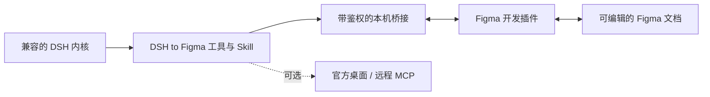

<div align="center">

# DSH to Figma

**把 Figma 画布能力接入 DeepSeek Harness。**

读取设计、编辑原生图层、操作组件与变量，让截图回到 Agent 的工作流程中。

[](https://github.com/Duoasa/DSH-to-Figma/actions/workflows/ci.yml)
[](LICENSE)
[](https://github.com/deepseek-ai/deepseek-harness)
[](docs/verification.md)

[English](README.md) · **简体中文**

[快速开始](#快速开始) · [工具列表](#工具列表) · [配置](#配置) · [验证记录](docs/verification.md)

</div>

## 为什么使用 DSH to Figma

- **原生 DSH 插件。** 工具、设计 Skill 和图像附件均使用宿主扩展机制，无需修改 Agent 主循环；支持 **0.2.0-rc.2** 与 **0.2.1-rc.2** 版 DSH 内核。
- **可继续编辑的设计。** 配套 Figma 插件在选定文档中执行公开 Plugin API，创建和修改 Frame、文字、自动布局、组件、变体、样式与变量。
- **从设计到代码。** 读取图层结构、布局、CSS 与素材，让宿主 Agent 在当前工作区中实现界面。
- **视觉反馈。** PNG 截图通过 DSH 原生图像附件机制传递。模型不支持图像时明确报告限制，不会假装完成视觉检查。
- **本地与官方 MCP 两种接入路径。** 默认使用本机配对插件，也可连接 Figma 官方桌面或远程 MCP，动态发现服务器实际提供的工具。

> **预览状态：** 已通过原生 DSH 加载与自动化协议、运行时测试。已验证真实 Figma 插件导入和本机配对；下方维护者提供的案例展示了将 UI 重建为可编辑图层的实机结果。完整读回、修改、导出及更多编辑器场景仍待验收。这是独立开发的集成，不是 DeepSeek / Figma 官方产品，也不宣称完整复刻 Codex 的所有云端能力。详见[验证记录](docs/verification.md)和[能力矩阵](CAPABILITIES.md)。

## 使用示例

### 从参考截图重建可编辑的 Figma 界面

在 DSH 中提供参考截图，在已连接的 Figma 文件中选中目标画板，再用自然语言描述绘制要求：

> 把这个 UI 绘制在我选中的画板上，注意只绘制 UI。

**1. 在 DSH 中提供参考图与指令。** 本例使用 DeepSeek Harness 桌面应用截图。Agent 识别选中的画板，计划按 1440 × 900 重建应用界面，并去除外围桌面背景。


**2. 在 Figma 中得到可编辑结果。** 画布呈现了侧边栏、对话区和消息输入区。左侧图层面板展示了独立的文字、Frame 和矢量图层，选中画板的尺寸为 1440 × 900，可以继续选择和调整其中的元素。


以上截图由维护者提供，来自 2026-10-18 的实际运行，展示了这次从截图到 UI 的案例；不代表逐像素一致性或所有工具、编辑器模式均已验收。

## 工作原理



配套插件连接 `http://localhost:3055`，桥接服务仅监听 `127.0.0.1:3055`。Figma 配套插件需要保持打开；每个 DSH Work 会话都必须明确选择目标文档。本地配对不需要 Figma Personal Access Token，也不依赖远程 OAuth 客户端审批；Figma 本身仍需正常的账号与文档访问权限。

## 快速开始

### 1. 安装 DSH 插件

准备 Git、用于开发的 **Node.js 24+**、兼容的 DSH 宿主，以及用于本地配对的 Figma 桌面应用。插件声明 Node 22+，实际请使用宿主要求的 Node 版本。已测试的 DSH 内核为 **0.2.0-rc.2** 和 **0.2.1-rc.2**。

当前通过 GitHub 源码分发，**尚未发布到 npm**。克隆仓库后安装本地目录：

```sh
git clone https://github.com/Duoasa/DSH-to-Figma.git
cd DSH-to-Figma
dsh plugin --profile web add "file:$PWD"
```

将 `web` 换成实际使用的 profile。运行时依赖由宿主包管理器安装；仓库已包含生成后的 Figma 插件入口，安装时无需构建。

**官方 macOS DSH Desktop：** 使用桌面应用自带的 CLI 管理保留的 `desktop` profile。如果应用位于下方路径：

```sh
"/Applications/DeepSeek Harness.app/Contents/Resources/runtime/cli/bin/dsh" \
  plugin --profile desktop add "file:$PWD"
```

应用路径不同时请相应调整。全局安装的另一份 `dsh` 可能版本较旧，且拒绝管理 `desktop`。也可以在 DSH 原生插件管理器中添加仓库的绝对路径。

打开 **插件 → DSH to Figma**，确认组件显示**运行中**。未自动重载时重启宿主。安装命令成功不等于插件已正常运行。

请使用兼容 DSH 内核宿主对应的 CLI、profile 和 `DSH_HOME`。如果已安装此插件的早期开发版本，请先禁用或移除，再启用当前包；重复版本使用相同的入口 ID 和桥接端口。

### 2. 配对 Figma

默认 DSH home 与 desktop profile 对应的命令为：

```sh
node "$HOME/.dsh/profiles/desktop/node_modules/dsh-to-figma/cli.mjs" \
  pair --home "$HOME/.dsh"
```

使用其他 profile / home 时，请同时调整路径和 `--home`。命令会输出已安装的 Figma 插件 manifest 路径及**本机配对密钥**；密钥只应粘贴到配套插件，不要发送到聊天、Issue 或截图中。

1. 在 Figma 桌面应用中打开一个测试 Design 文件。
2. 选择 **Plugins → Development → Import plugin from manifest…**，导入命令输出的 `companion/manifest.json`。
3. 运行 **DSH to Figma**，粘贴配对密钥，点击 **Connect / 连接 DSH**。
4. 保持插件打开。在具有工作区的 DSH **Work 会话**中，让 Agent 调用 `figma_status`，再用目标 connection ID 调用 `figma_select_document`。

### 3. 体验完整工作流

可以直接对 Agent 说：

> 读取 figma-workbench Skill。列出已连接的 Figma 文档，绑定我指定的测试文件。先检查当前页面，再新建一张标题为“Hello from DSH”的自动布局卡片。返回节点 ID，读回卡片，把标题改成“Connected”，最后返回截图。不要修改已有设计。

完整流程是 **检查 → 编辑 → 读回 → 截图**。写入超时后，应先检查实际画布，再决定是否重试；超时不会自动撤销 Figma 中的修改。

## 工具列表

本地模式提供 **17 个画布工具**，名称前缀为 `mcp__figma__…`，另有 4 个配对与指南工具。

| 工作流 | 本地工具 |
| --- | --- |
| 画布脚本 | `use_figma`、`import_scene` |
| 结构检查 | `get_selection`、`list_fonts`、`get_metadata` |
| 截图与设计上下文 | `get_screenshot`、`get_design_context`、`get_figjam` |
| 设计系统 | `get_variable_defs`、`get_libraries`、`search_design_system`、`get_component_context` |
| 组件与代码引用 | `get_local_component_links`、`set_local_component_links` |
| 动效信息 | `get_motion_context` |
| 素材传输 | `upload_assets`、`download_assets` |
| 配对与指南 | `figma_status`、`figma_select_document`、`figma_read_guide`、`figma_reconnect` |

内置 `figma-workbench` Skill，并附带画布脚本、设计转代码、组件与变量、素材与场景、FigJam / Slides、官方服务等专项指南。本地组件引用保存在插件数据中，**不等同于发布 Code Connect 映射**。设计系统搜索按实际实现覆盖本地范围，不是全云端搜索。公开 API 脚本可面向 Design、FigJam 和 Slides；各编辑器的实机验收仍待完成。

云端专属能力及工具协议差异见[能力矩阵](CAPABILITIES.md)。

## 配置

通过宿主原生插件配置设置 `dsh-figma` 入口。下表是**入口 config 字段**，不是完整的 profile patch：

| 字段 | 默认值 | 用途 |
| --- | --- | --- |
| `backend` | `local` | `local`、`desktop` 或 `remote` |
| `bridgePort` | `3055` | 本机配套插件桥接端口 |
| `desktopServerUrl` | `http://127.0.0.1:3845/mcp` | 官方桌面 MCP 地址 |
| `toolCallTimeoutMs` | `120000` | 工具超时，范围 1–300 秒 |
| `oauthClientId` | 空 | 需要时填写已获批的远程 OAuth client ID |

修改 `bridgePort` 时，还必须同步修改配套插件 UI 地址及 manifest 的 `devAllowedDomains`。没有明确需求时，保持 `3055`。

- **桌面模式：** 开启 Figma 桌面 MCP 服务，设置 `backend: desktop`，再调用 `figma_reconnect` 刷新。
- **远程模式：** 通过 `dsh-figma login` 登录，设置 `backend: remote`。能力取决于 Figma 客户端审批、账号、席位和服务器实际工具列表，不复用 Codex 凭证。
- **禁用：** 使用宿主插件管理器，或设置环境变量 `DSH_FIGMA_DISABLED=1` 后启动宿主。

[详细接入、OAuth 和故障排查 →](docs/setup.md)

## 数据与执行边界

- 本地服务仅监听 loopback，检查 Host / Origin，每个请求都需要配对密钥。密钥保存在 `DSH_HOME/figma` 下，使用私有文件权限；Figma 插件仅在内存中保存它。
- Figma 脚本通过公开 Plugin API 在编辑器中执行。DSH 插件本身与其他原生插件一样，以宿主进程权限运行。
- 目标文档必须明确绑定，同一文档操作串行执行；结果未知的写入不会自动重放。画布修改不是事务。
- 素材上传不能超出当前 Work 工作区，导出写入全新的 `.figma/assets/<batch>/` 目录。截图作为对话内容，可能发送给你配置的模型提供方。
- OAuth 凭证保存在私有本地文件中，**没有使用系统钥匙串加密**。`dsh-figma logout` 删除本地凭证；如需让服务器授权失效，还要在 Figma 中撤销应用访问。

## 开发

```sh
npm ci --ignore-scripts
npm run test:all
npm pack --ignore-scripts
```

`check` 会从源文件重新生成 `companion/code.js`，检查语法和包内容。测试覆盖 HTTP 鉴权、文档队列、取消与恢复、素材、OAuth、官方 MCP 发现，以及真实 DSH 服务与附件集成。自动化中的 Figma API 使用模拟 fixture。

```text
index.mjs             原生 DSH 插件入口
cli.mjs               安装、配对与 OAuth 辅助命令（dsh-figma）
lib/                  桥接、工具目录、素材和官方传输
companion/            Figma 开发插件，包含生成后的 code.js
skills/               工作流 Skill 与专项指南
test/                 单元、协议与原生 DSH 集成测试
docs/                 接入与验证说明
```

使用其他已安装内核的方式见[验证说明](docs/verification.md)。欢迎提交改进与可复现的问题；请附上 DSH 版本、backend 和错误信息，并删除密钥及私人设计数据。

## 致谢与许可

基于 [DeepSeek Harness](https://github.com/deepseek-ai/deepseek-harness)、[Figma Plugin API](https://developers.figma.com/docs/plugins/api/figma/) 和 [Model Context Protocol SDK](https://github.com/modelcontextprotocol/typescript-sdk) 构建。

README 结构参考社区项目 [dsh-context](https://github.com/bowenliang123/dsh-context)、[dsh-plugin-shop](https://github.com/LivXue/dsh-plugin-shop) 和 [dsh-openpencil](https://github.com/ZSeven-W/dsh-openpencil)，本仓库未打包它们的代码或截图。

[MIT](LICENSE) · Copyright © 2026 Duoasa.
