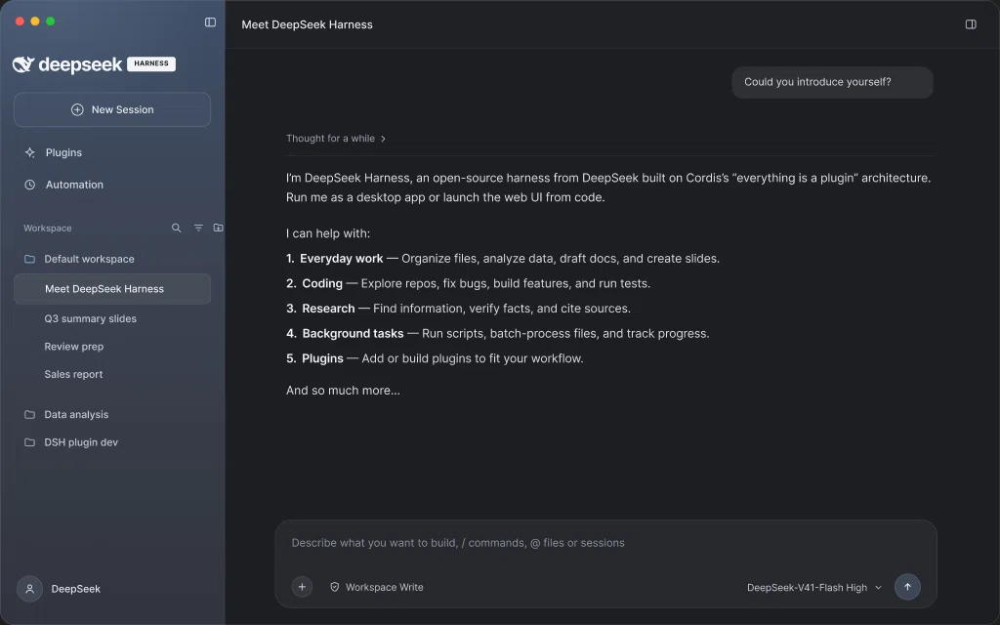
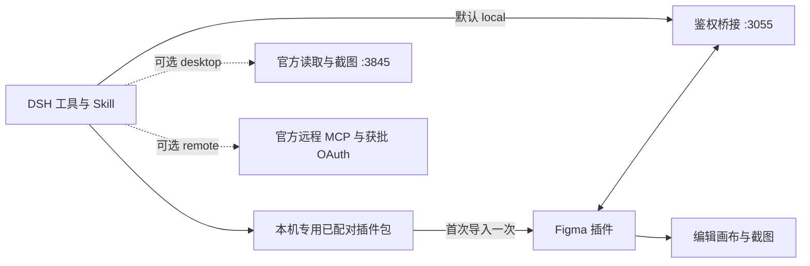

<div align="center">

# DSH to Figma

**把 Figma 画布能力接入 DeepSeek Harness。**

原生 DSH 插件搭配自动配对的 Figma 插件，直接读取、编辑画布并获取截图。首次导入一次，以后启动即连接。

[](https://github.com/Duoasa/DSH-to-Figma/actions/workflows/ci.yml)
[](LICENSE)
[](https://github.com/deepseek-ai/deepseek-harness)
[](docs/verification.md)

[English](README.md) · **简体中文**

[快速开始](#快速开始) · [工具列表](#工具列表) · [配置](#配置) · [验证记录](docs/verification.md)

</div>

> **推荐安装方式：** 从 [Releases](https://github.com/Duoasa/DSH-to-Figma/releases/latest) 下载并安装 DSH 包。插件以本地模式启动后，**DSH 会自动生成这台电脑专用、已配对的 Figma 插件**。让 DSH 调用 `figma_setup` 获取路径，在 Figma 首次导入一次生成的 manifest，之后运行即可连接。无需另行下载通用 ZIP，也无需复制配对密钥；使用时保持 Figma 插件窗口打开。

## 为什么使用 DSH to Figma

- **原生 DSH 插件。** 工具、设计 Skill 和图像附件均使用宿主扩展机制，无需修改 Agent 主循环；支持 **0.2.0-rc.2** 与 **0.2.1-rc.2** 版 DSH 内核。
- **默认支持画布编辑（`local`）。** 配套 Figma 插件在选定文档中执行公开 Plugin API，创建和修改 Frame、文字、自动布局、组件、变体、样式与变量。
- **从设计到代码。** 读取图层结构、布局、CSS 与素材，让宿主 Agent 在当前工作区中实现界面。
- **视觉反馈。** 画布截图通过 DSH 原生图像附件机制传递。模型不支持图像时明确报告限制，不会假装完成视觉检查。
- **推荐流程无需复制密钥。** DSH 自动生成本机专用的已配对 Figma 插件，运行后自动连接；只有一个连接文件时自动选用。官方桌面 MCP 保留为可选的读取与截图模式。

> **0.2.1 已在 Figma 设计模式实测：** 自动配对、单文件绑定、原生画板与文字创建、独立读回修改、截图及 PNG 导出均通过已安装 DSH 的真实会话完成。此版本修复了 0.2.0 实机发现的沙箱启动兼容问题，详见[验证记录与实际图片](docs/verification.md)。

## 使用示例

### 官方桌面 MCP 读取与截图（可选模式）

在 DSH Work 会话中，提供当前 Figma 文件内目标画板的链接：

> 使用官方桌面 MCP，先检查 figma_status，再读取这个画板的元数据并返回截图，不要修改画布。

实测发现 **10 个官方工具**，状态为 `backend: desktop`、`available: true`、`bridgePort: null`。`get_metadata` 成功读取 **DeepSeek Harness — Desktop UI**，节点 `1:4`，尺寸 **1440 × 900**，以及 Sidebar、Main 等内部图层。`get_screenshot` 返回 **1024 × 640 WebP**，进入 DSH 原生图片附件存储，并在实际对话中显示。下图就是该次 MCP 返回的图片；验收没有修改画布。



### 从参考截图重建可编辑的 Figma 界面（本地模式）

此写入案例使用 `backend: local` 和配套插件；0.2.0 通过自动配对简化了它的接入过程。在 DSH 中提供参考截图，在已连接的 Figma 文件中选中目标画板，再用自然语言描述绘制要求：

> 把这个 UI 绘制在我选中的画板上，注意只绘制 UI。

**1. 在 DSH 中提供参考图与指令。** 本例使用 DeepSeek Harness 桌面应用截图。Agent 识别选中的画板，计划按 1440 × 900 重建应用界面，并去除外围桌面背景。


**2. 在 Figma 中得到可编辑结果。** 画布呈现了侧边栏、对话区和消息输入区。左侧图层面板展示了独立的文字、Frame 和矢量图层，选中画板的尺寸为 1440 × 900，可以继续选择和调整其中的元素。


以上截图由维护者提供，来自 2026-10-18 的实际运行，展示了这次从截图到 UI 的案例；不代表逐像素一致性或所有工具、编辑器模式均已验收。

## 工作原理



DSH 在本地模式启动时，会在 `<DSH_HOME>/figma/` 自动生成已配对的插件目录和 ZIP。首次导入 manifest 后，每次在 Figma 运行 **DSH to Figma · Local** 就会自动连接这台 DSH。使用时保持插件窗口打开，无需远程 OAuth 或个人访问令牌。

已配对版本包含本机凭证，请保留在本机；公开分发包不含凭证。桥接仍只监听本机并验证密钥，没有新增匿名获取密钥的网络接口。空闲断线会自动重连，执行中断的画布操作不会自动重放。

## 快速开始

### 1. 安装 DSH 插件

准备兼容的 DSH 宿主，以及用于导入开发插件的 Figma 桌面端；只有源码安装方式需要 Git。Node 使用宿主要求的版本，仓库开发使用 **Node.js 24+**。已测试 DSH 内核 **0.2.0-rc.2** 和 **0.2.1-rc.2**。本地模式使用 Figma Plugin API，不依赖官方桌面 MCP 的付费席位条件，但仍需正常账号、文件编辑权限及编辑器权限。

从 [Releases](https://github.com/Duoasa/DSH-to-Figma/releases/latest) 下载 **dsh-to-figma-0.2.1.tgz**。**尚未发布到 npm**。使用宿主 CLI 安装下载的文件：

```sh
dsh plugin --profile web add "file:/绝对路径/dsh-to-figma-0.2.1.tgz"
```

将 `web` 换成实际使用的 profile。运行时依赖由宿主包管理器安装，无需自行构建。

**官方 macOS DSH Desktop：** 使用桌面应用自带的 CLI 管理保留的 `desktop` profile：

```sh
"/Applications/DeepSeek Harness.app/Contents/Resources/runtime/cli/bin/dsh" \
  plugin --profile desktop add "file:/绝对路径/dsh-to-figma-0.2.1.tgz"
```

将包路径替换为实际下载位置；应用路径不同时也请相应调整。全局安装的另一份 `dsh` 可能版本较旧，且拒绝管理 `desktop`。

也可克隆源码，在仓库目录中用同一宿主 CLI 安装 `"file:$PWD"`。只有这种备用方式需要 Git。

打开 **插件 → DSH to Figma**，确认组件显示**运行中**。未自动重载时重启宿主。安装命令成功不等于插件已正常运行。

请使用兼容 DSH 内核宿主对应的 CLI、profile 和 `DSH_HOME`。如果已安装此插件的早期开发版本，请先禁用或移除，再启用当前包；重复版本使用相同的入口 ID 和桥接端口。

### 2. 首次导入自动配对的 Figma 插件

DSH 以本地模式启动后，对它说：

> 帮我连接 Figma，调用 figma_setup，把已配对插件的 manifest 路径给我。不要显示密钥，也不要读取生成的代码。

默认 DSH home 对应的路径是：

```text
~/.dsh/figma/companion/manifest.json
```

1. 在 Figma 桌面端选择 **Plugins → Development → Import plugin from manifest…**。
2. 选择生成的 manifest。macOS 文件选择器可按 **⌘⇧G** 输入完整路径。
3. 打开目标 Design 文件，运行 **DSH to Figma · Local**。
4. 插件自动连接，正常流程无需粘贴密钥。保持插件窗口打开即可。

此目录位置稳定，DSH 插件升级后重新运行 Figma 插件即可。不要移动或删除该目录。`figma_setup` 也会返回本机专用的 **DSH-to-Figma-paired.zip**；如选择压缩包，先解压到固定目录再导入。解压后的独立副本需要在升级时手动更新。

### 3. 开始使用

> 读取已连接的 Figma 文件，新建一张独立的自动布局卡片，标题为“Hello from DSH”。返回节点 ID，读回内容并截图。不要改动已有设计。

只有一个连接文件时，首次画布调用自动绑定；同时连接多个文件时明确选择目标。已有绑定断开后不会悄悄切换到其他文件。写入失败可能已产生部分修改，应先检查再重试。

**从 0.1.5 升级：** 若 profile 显式写了 `backend: desktop`，改为 `local` 后重启或重载。新包的默认值不会覆盖用户已有配置。[接入说明](docs/setup.md)包含可直接使用的 patch。

### 独立 Figma 安装包——手动配对备用方案

**推荐流程不需要下载此包。** DSH 会自动生成已配对插件。[Releases](https://github.com/Duoasa/DSH-to-Figma/releases/latest) 中单独提供的 `DSH-to-Figma-companion-0.2.1.zip` 是不含凭证的通用包，需要手动配对。成功的 [GitHub Actions 构建](https://github.com/Duoasa/DSH-to-Figma/actions/workflows/ci.yml)也会通过 **DSH-to-Figma-packages** 提供两端公开安装包。

自动生成的专用插件目录及 `DSH-to-Figma-paired.zip` 含本机凭证，请保留在本机，勿上传或分享；公开 Release 不包含这些私有文件。

运行 `npm run package:companion`，生成 `dist/DSH-to-Figma-companion-0.2.1.zip`，内含 manifest、编译后的插件、界面、中英文安装说明和许可证。该通用包不含凭证，可公开分发。想免复制密钥，请使用**自己这台 DSH** 生成的已配对版本；通用版也保留“高级设置”中的手动配对入口。

也可通过 `node /插件绝对路径/cli.mjs setup --home /DSH-home绝对路径` 生成本机安装包，命令只输出安装路径，不输出密钥。

## 工具列表

默认本地模式提供 **17 个画布工具**，名称前缀为 `mcp__figma__…`，另有 5 个接入与指南工具。可选官方模式动态提供服务器实际工具目录；官方桌面模式没有 `use_figma` 画布写入工具。

| 工作流 | 本地工具 |
| --- | --- |
| 画布脚本 | `use_figma`、`import_scene` |
| 结构检查 | `get_selection`、`list_fonts`、`get_metadata` |
| 截图与设计上下文 | `get_screenshot`、`get_design_context`、`get_figjam` |
| 设计系统 | `get_variable_defs`、`get_libraries`、`search_design_system`、`get_component_context` |
| 组件与代码引用 | `get_local_component_links`、`set_local_component_links` |
| 动效信息 | `get_motion_context` |
| 素材传输 | `upload_assets`、`download_assets` |
| 配对与指南 | `figma_setup`、`figma_status`、`figma_select_document`、`figma_read_guide`、`figma_reconnect` |

内置 `figma-workbench` Skill，并附带画布脚本、设计转代码、组件与变量、素材与场景、FigJam / Slides、官方服务等专项指南。本地组件引用保存在插件数据中，**不等同于发布 Code Connect 映射**。设计系统搜索按实际实现覆盖本地范围，不是全云端搜索。公开 API 脚本可面向 Design、FigJam 和 Slides；各编辑器的实机验收仍待完成。

云端专属能力及工具协议差异见[能力矩阵](CAPABILITIES.md)。

## 配置

通过宿主原生插件配置设置 `dsh-figma` 入口。下表是**入口 config 字段**，不是完整的 profile patch：

| 字段 | 默认值 | 用途 |
| --- | --- | --- |
| `backend` | `local` | `local`、`desktop` 或 `remote` |
| `bridgePort` | `3055` | 本机配套插件桥接端口 |
| `desktopServerUrl` | `http://127.0.0.1:3845/mcp` | 官方桌面 MCP 地址 |
| `toolCallTimeoutMs` | `120000` | 工具超时，范围 1–300 秒 |
| `oauthClientId` | 空 | 需要时填写已获批的远程 OAuth client ID |

修改 `bridgePort` 后，DSH 自动为已配对插件生成匹配的地址和 manifest 白名单；重启 DSH 后，按需重新运行或导入生成的插件。多个宿主应使用不同端口和各自生成的配套插件。

- **本地模式（默认）：** 自动生成已配对插件，启动即连接，单文件自动选用。
- **桌面模式（可选）：** 启用 Figma 内置桌面 MCP，设置 `backend: desktop` 并重启或重载 DSH。只支持读取与截图，无需配套插件；套餐条件见[官方说明](https://developers.figma.com/docs/figma-mcp-server/local-server-installation/)。
- **远程模式：** 通过 `dsh-figma login` 登录，设置 `backend: remote`。能力取决于 Figma 客户端审批、账号、席位和服务器实际工具列表，不复用 Codex 凭证。
- **禁用：** 使用宿主插件管理器，或设置环境变量 `DSH_FIGMA_DISABLED=1` 后启动宿主。

[详细接入、OAuth 和故障排查 →](docs/setup.md)

## 数据与执行边界

- 本地服务仅监听 loopback，检查 Host / Origin，每个请求都需要配对密钥。密钥保存在 `DSH_HOME/figma` 下，使用私有文件权限；已配对插件文件包含本机私有副本，运行时在内存中使用，不写入 Figma 文档数据或 clientStorage。
- Figma 脚本通过公开 Plugin API 在编辑器中执行。DSH 插件本身与其他原生插件一样，以宿主进程权限运行。
- 本地模式下，单文件首次自动绑定，多文件或旧绑定断开后需要明确选择；同一文档操作串行执行；结果未知的写入不会自动重放。画布修改不是事务。
- 素材上传不能超出当前 Work 工作区，导出写入全新的 `.figma/assets/<batch>/` 目录。截图作为对话内容，可能发送给你配置的模型提供方。
- OAuth 凭证保存在私有本地文件中，**没有使用系统钥匙串加密**。`dsh-figma logout` 删除本地凭证；如需让服务器授权失效，还要在 Figma 中撤销应用访问。

## 开发

```sh
npm ci --ignore-scripts
npm run test:all
npm pack --ignore-scripts
```

`check` 会从源文件重新生成 `companion/code.js`，检查语法和包内容。测试覆盖 HTTP 鉴权、文档队列、取消与恢复、素材、OAuth、官方 MCP 发现，以及真实 DSH 服务与附件集成。自动化中的 Figma API 使用模拟 fixture。

```text
index.mjs             原生 DSH 插件入口
cli.mjs               安装、配对与 OAuth 辅助命令（dsh-figma）
lib/                  桥接、工具目录、素材和官方传输
companion/            Figma 开发插件，包含生成后的 code.js
skills/               工作流 Skill 与专项指南
test/                 单元、协议与原生 DSH 集成测试
docs/                 接入与验证说明
```

使用其他已安装内核的方式见[验证说明](docs/verification.md)。欢迎提交改进与可复现的问题；请附上 DSH 版本、backend 和错误信息，并删除密钥及私人设计数据。

## 致谢与许可

基于 [DeepSeek Harness](https://github.com/deepseek-ai/deepseek-harness)、[Figma Plugin API](https://developers.figma.com/docs/plugins/api/figma/) 和 [Model Context Protocol SDK](https://github.com/modelcontextprotocol/typescript-sdk) 构建。

README 结构参考社区项目 [dsh-context](https://github.com/bowenliang123/dsh-context)、[dsh-plugin-shop](https://github.com/LivXue/dsh-plugin-shop) 和 [dsh-openpencil](https://github.com/ZSeven-W/dsh-openpencil)，本仓库未打包它们的代码或截图。

[MIT](LICENSE) · Copyright © 2026 Duoasa.
